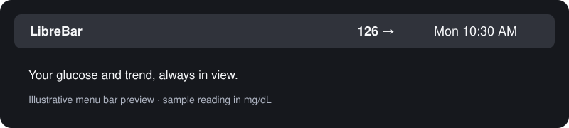
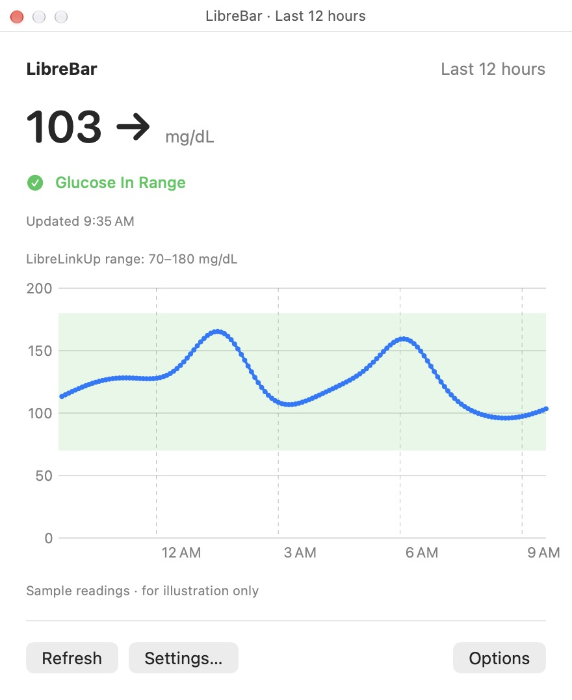
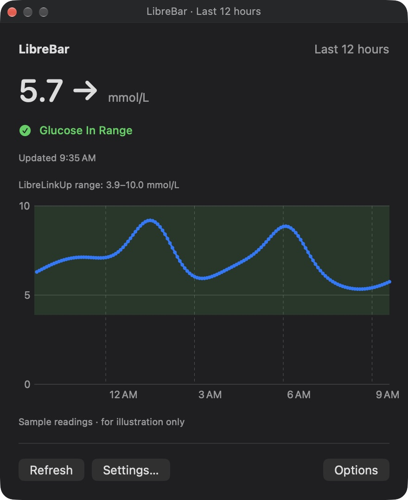

# LibreBar

Current version: **0.2.0**.

A native Mac menu bar display for LibreLinkUp glucose readings. Requires macOS 13 or later and Apple’s Swift command-line tools. Builds for your Mac’s architecture; tested on Apple Silicon. No Dock icon, web server, analytics, or external dependencies.

**Unofficial personal project.** Not affiliated with, endorsed by, or supported by Abbott. This uses an undocumented API that may change or stop working. Use the official Libre app for treatment decisions and alarms; LibreBar is a convenience display.



## History graph

Click the menu bar reading to open the last 12 hours. The green band follows the target range shared by LibreLinkUp; “Glucose In Range” appears when the current value is inside it.

Screenshots of the native panel with synthetic sample readings, not personal glucose history:

| Light appearance · mg/dL | Dark appearance · mmol/L |
| --- | --- |
|  |  |


## Build and connect

Install Apple’s command-line tools if needed with `xcode-select --install`, then clone and build:

```sh
git clone https://github.com/tcullum/LibreBar.git
cd LibreBar
./build.sh
open build/LibreBar.app
```

The app is locally signed, not Apple-notarized. No prebuilt download is provided. Building does not change an already-running copy; quit and reopen LibreBar to use a new build.


1. Run `./build.sh`, then open `build/LibreBar.app`.
2. Use a LibreLinkUp follower account. In your Libre sensor app, open Connected Apps → LibreLinkUp and invite that account. In the official LibreLinkUp app, accept the invitation, finish email verification, and accept any required terms.
3. Enter that follower account’s email and password in LibreBar Settings and click Save & Connect.
4. If the account follows multiple people, choose your name in the menu bar menu.

The menu bar shows the glucose value and trend arrow. Click it to open a graph of the last 12 hours, with the current reading, timestamp, Refresh, and Settings. Options contains units, connection selection, login settings, and Quit. The graph highlights the connection’s `targetLow`–`targetHigh` range from LibreLinkUp and shows “Glucose In Range” when the latest value falls within it (inclusive). Missing or invalid targets use a clearly labeled 70–180 mg/dL default. Both the band and label follow the selected display units. These are target glucose values, not alarm thresholds. Close the panel with its close button, Escape, a second click on the menu bar reading, or a click outside. History is fetched from LibreLinkUp and stays in memory; missing periods are left as gaps, and fewer than 12 hours may be available. Choose Show mmol/L if preferred; the default is mg/dL. It refreshes every minute while the Mac is awake and after waking. A warning symbol indicates a reading older than five minutes or an unknown/invalid timestamp. If a refresh fails, the previous reading remains visible and its timestamp continues to age; open the menu to see the error.

Launch at Login is optional and starts off. Choose a permanent location for the app before enabling it. macOS may require approval in System Settings → General → Login Items. Login launch has not been verified across a restart.

## Privacy

Credentials are stored in macOS Keychain. Requests go only to Abbott’s LibreLinkUp service, including its regional endpoints. Tokens and glucose readings stay in memory. Only unit preference and selected connection ID are stored in app preferences. Sign Out removes the saved credentials. No credentials or glucose history are included in this repository. Do not post credentials, access tokens, or personal glucose data in issues.

## Limits

This is an unofficial convenience display using an undocumented API, which Abbott can change. It is not a treatment or alarm device. Continue using the official Libre app for treatment decisions and alarms. Live authentication and glucose retrieval were confirmed by the original user. Other account regions have not been independently tested. Unknown timestamps are flagged rather than assumed current.

## Source and checks

Source is in `Sources/LibreBar.swift`; the app bundle metadata is in `Resources/Info.plist`. Run `./build.sh` with Apple’s Swift command-line tools installed. The app is written to `build/LibreBar.app`. The build includes checks for reading parsing, unit conversion, trend arrows, UTC timestamp parsing, and stale/missing data. The app bundle passed signature verification and the settings screen was visually inspected. It is locally signed, not Apple-notarized.

API references:
- https://www.librelinkup.com/
- https://github.com/smpurkis/libre-linkup-py
- https://github.com/timoschlueter/nightscout-librelink-up

No third-party client code or runtime is bundled.

## Support and contributions

This is a personal project with community support and no uptime or maintenance guarantee. Bug reports and pull requests are welcome. For connection problems, check that the official LibreLinkUp app shows your readings first. Include your macOS version and a redacted error description when reporting an issue.

## License

[MIT](LICENSE). FreeStyle, Libre, LibreLinkUp, and related marks belong to Abbott. The license covers this project’s code, not Abbott’s services or trademarks.
